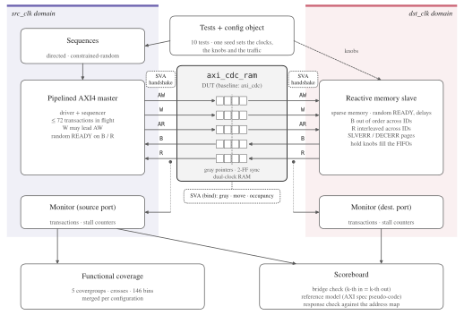
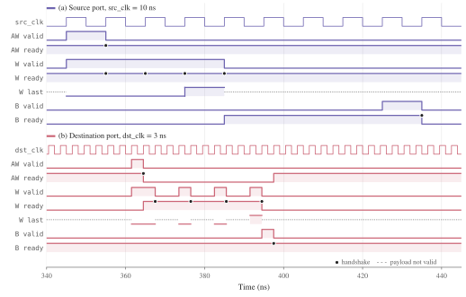
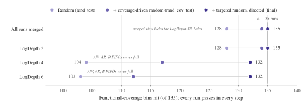

# AXI4 CDC Verification: UVM Environment for a BRAM-Based Bridge


A coverage-driven UVM testbench for `axi_cdc_ram`, an AXI4 clock-domain-crossing
bridge whose five asynchronous FIFOs keep their data in dual-clock memory so
FPGA tools can map them to block RAM. I designed that RTL for the PULP
platform ([pulp-platform/axi#294](https://github.com/pulp-platform/axi/issues/294),
[pulp-platform/common_cells#369](https://github.com/pulp-platform/common_cells/pull/369));
this repository verifies it against the original register-based `axi_cdc`
with the same seeds, from transaction level down to the gray-code pointers
that cross the clock boundary.

**Keywords:** SystemVerilog · UVM 1.2 · SVA (concurrent assertions, `bind`) ·
constrained-random verification · coverage-driven verification (covergroups,
crosses, `ignore_bins`, coverage closure) · scoreboard with reference model ·
fault injection · AXI4 (bursts, narrow and unaligned transfers, write
strobes, outstanding transactions) · clock-domain crossing (async FIFO, gray
code, 2-FF synchronizer) · regression automation (bash, Python) · Cadence Xcelium

## At a glance

| | |
|---|---|
| **Regression** | 198 runs + 3 fault-injection runs, 0 failures, signed off automatically; 3 min on one machine |
| **Traffic checked** | 38,714 writes, 67,233 reads, 1,024,510 data beats; every field of every beat on both ports |
| **Functional coverage** | 135/135 bins in 5 covergroups; every configuration hits all 83 transaction, flow and order bins |
| **Assertions** | 85 on `axi_cdc_ram`: 40 AXI handshake rules on both ports, 45 CDC pointer rules bound into the 5 FIFOs; 0 fires |
| **Fault injection** | 3/3 faults caught by the intended checker; one of them is visible to the assertions only |
| **Configurations** | `LogDepth` 1, 2, 4, 6; RAM FIFOs vs. register FIFOs; clocks 2-30 ns, ratios up to 10:1 in both directions, coincident-edge corners |
| **Reproducibility** | one seed sets clocks, knobs and traffic; adding coverage and assertions left every number of earlier runs unchanged |

## Design under test

`axi_cdc_ram` has the same ports as `axi_cdc`: an AXI4 slave port on
`src_clk` and an AXI4 master port on `dst_clk`. Each of the five channels
crosses through its own asynchronous FIFO (AW, W, AR from source to
destination; B, R back). Read and write pointers are gray-coded and pass
through 2-FF synchronizers; the data stays in a dual-clock memory with
2<sup>LogDepth</sup>+1 entries (the register version holds +2). A CDC FIFO
fails in rare corners: full and empty boundaries, pointer wrap-around,
clock ratios, and edges that arrive at the same time. The plan is built
around those corners.

## Testbench



*Fig. 1. Testbench. Two clock domains, the DUT between them; handshake
assertions sit on both AXI ports, CDC assertions are bound inside the DUT.*

| Component | Implementation |
|---|---|
| Master agent | cycle-based pipelined driver on clocking blocks; up to 72 transactions in flight; W may lead AW; random READY on B and R; a hold knob that stops responses until FIFOs fill |
| Memory slave | reactive, sparse byte memory; random READY and latency on every channel; a hold knob for requests |
| Monitors (x2) | rebuild transactions from handshakes; protocol checks (`WLEN`, `RLAST`, `BNOAW`, `RNOAR`); stall counters per channel |
| Scoreboard | bridge check: the k-th transaction out equals the k-th in, every field and beat; end-to-end check against a reference memory (active byte lanes, AXI A3.4.3; narrow, unaligned, FIXED/INCR/WRAP) |
| Coverage | 5 covergroups: transaction shape, per-cycle DUT events (FIFO full, back-to-back output, AW/W order on both sides), clock relation, FIFO full x clock relation; illegal FIXED/WRAP lengths excluded with `ignore_bins`; bins also counted in the collector, so [tools/merge_cov.py](tools/merge_cov.py) merges runs without a coverage-tool licence |
| Assertions | [axi_handshake_sva.sv](tb/sva/axi_handshake_sva.sv): VALID held until READY, payload stable, no X, VALID low after reset. [cdc_fifo_sva.sv](tb/sva/cdc_fifo_sva.sv), bound into every FIFO: one bit per pointer change, pointer moves exactly on a handshake, occupancy in 0..2<sup>LogDepth</sup> (each side's view and the real one) |
| Stimulus | 8 tests: directed (bursts, ordering, back-pressure, FIFO full), clock sweep, constrained random (`dist`, implications, AXI legality constraints), targeted random for deep FIFOs |
| Regression | [sim/regress.sh](sim/regress.sh) runs everything, merges coverage per configuration and applies the sign-off rules of the [verification plan](docs/vplan.md); exit code 0 only when signed off |



*Fig. 2. One 4-beat write crossing from a 10 ns to a 3 ns clock (simulation of
this testbench). Dots mark handshakes. The B response reaches the source port
on the third `src_clk` edge after the slave's B handshake: two synchronizer
stages, then the FIFO's output register.*

## Coverage closure



*Fig. 3. Bins hit per step. Random traffic alone looked like 95% when all runs
were merged, but with `LogDepth` 4 and 6 the AW, AR and B FIFOs were never
full: at most 16 transactions were in flight and those FIFOs hold 17 to 66.
Coverage-driven random added long bursts, more transactions in flight than
the deepest FIFO, and clock corners; targeted random and directed fills
closed the rest. The 3 bins left per deep configuration are clock-relation
crosses, required over all runs (all hit).*

## Fault injection

Each fault is injected on purpose; the run must fail, and the right checker
must catch it.

| Fault | Scoreboard | Assertions |
|---|---|---|
| bit 0 of R data flipped at the DUT output | 7 errors | 0 |
| AW address changed while VALID=1, READY=0 | **0 errors** | `SVA_AW` fires one cycle later |
| two bits of a crossing gray pointer flipped for one cycle | 0 errors | `SVA_OCC` at the next clock edge (real occupancy 6 in a 4-entry FIFO), again on the write side's view two synchronizer cycles later; `SVA_GRAY` at the next edge of the pointer's own clock |

The second row is why the assertions exist: the DUT and both monitors take
the payload at the handshake, so they all agree, and only the handshake rule
sees the violation.

## Findings

* **The upstream testbench never filled the FIFOs.** All its tests pass, yet
  no FIFO was ever full. A FIFO-full test with scenario checks closed the gap
  for both designs.
* **Merged coverage hid holes** (Fig. 3). Coverage has to be read per
  configuration.
* **The directed burst test looked complete but missed 17-255 beats.**
* **A checker caught my own stimulus.** A read raced a write to the same
  address; AXI does not order the read and write channels, so the fix was in
  the test, not in the DUT.
* **Coincident clock edges** add one synchronizer cycle in simulation. Real
  hardware could resolve either way, so RTL simulation cannot prove CDC
  safety; that needs structural CDC checks and timing constraints.
* **Seeds are stable.** After adding the coverage collector and 85 assertions,
  every earlier run gave the same clocks, transaction counts, stall cycles
  and end time: the checkers only observe.

## Run it

Needs Cadence Xcelium with UVM 1.2 (tested: Xcelium 23.09, `CDNS-1.2`),
bash and python3.

```sh
bash sim/regress.sh            # full regression; writes logs/regress/results.md
bash sim/regress.sh quick      # about 1 minute
bash sim/run_one.sh rand_cov_test 7 1 2 +RAND_CLOCKS +CLK_CORNERS +VCD   # one seed, with waves
```

`run_one.sh <test> <seed> [USE_RAM] [LOG_DEPTH] [plusargs]`. `USE_RAM=1`
selects `axi_cdc_ram`, `0` the original `axi_cdc`. Tests: `smoke_test`,
`burst_test`, `order_test`, `backpressure_test`, `fifo_full_test`,
`rand_test`, `rand_cov_test`, `rand_deep_test`. Full results:
[docs/results.md](docs/results.md); plan and sign-off rules:
[docs/vplan.md](docs/vplan.md).

## Layout

```
rtl/        vendored PULP RTL and the DUT (sources and versions: rtl/README.md)
tb/uvm/     UVM package: item, driver, slave, monitors, scoreboard, coverage, sequences, tests
tb/sva/     handshake and CDC assertions
tb/top/     tb_top: DUT, interfaces, clocks, resets, binds, fault injection
sim/        regress.sh, run_one.sh, common.sh
tools/      coverage merge, results page, figures
docs/       verification plan, results, figures
```

## Known issue

On Debian 12, Xcelium 23.09 prints `*E,IMPDLL` at start-up: its bundled
linker (binutils 2.34) cannot read the system `libm.so.6` (DT_RELR), so the
UVM library's DPI export file is not built. This testbench uses no DPI
exports, every test runs normally, and the scripts ignore this one message.

## License and credits

Testbench, scripts and docs: Apache-2.0 ([LICENSE](LICENSE)). RTL in `rtl/`:
SHL-0.51, from the PULP platform (ETH Zurich and University of Bologna); see
[rtl/README.md](rtl/README.md).

Parts of the testbench were written with help from Claude (Anthropic).
